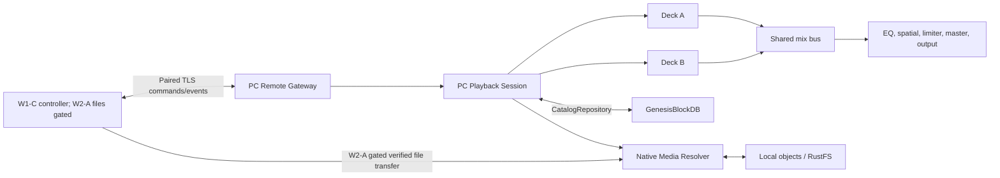

# CR-008 — Mobile remote, phone host and DJ-style transitions

## Request

ออกแบบมือถือให้เป็นรีโมทควบคุม Lalin Play บน PC, เพิ่มเพลง/playlist เข้า queue,
เชื่อม playlist จาก YouTube, ใช้ไฟล์เพลงในมือถือเป็นแหล่งสื่อเมื่อ PC ไม่มี
อินเทอร์เน็ต และทำ crossfade/medley โดยให้ playback ค่อย ๆ เปลี่ยนระหว่างเพลง.

สถานะเอกสารเป็น **approved**: ผู้ใช้อนุมัติ CR-008 เมื่อ 2026-10-20 ให้เริ่ม
implementation ตามขอบเขตด้านล่าง โดยไม่รวม YouTube media playback/download,
public WAN exposure, automatic tethering หรือการอ้าง beat-perfect/sample-accurate mixing.

## Source constraints

- `audioEngine.ts` ปัจจุบันมี persistent media element เดียว, หนึ่ง
  `MediaElementAudioSourceNode` และ `AudioContext` ร่วม; CR-006 pin การใช้
  media element เดียว. Crossfade สอง deck ต้อง supersede เฉพาะจำนวน decoder
  โดยยังมี playback owner, `AudioContext`, master/output chain เพียงหนึ่งชุด.
- `usePlaybackStore.ts` เป็นเจ้าของ queue ปัจจุบันและเลื่อนไปเพลงถัดไปเมื่อ
  `ended`; transition coordinator ต้องเป็นผู้เดียวที่ commit การเปลี่ยนเพลง
  เพื่อไม่ให้ `ended` และ fade จบแล้ว advance ซ้ำ.
- Queue ต้องเพิ่ม `queueEntryId`; track ID เดียวกันอาจอยู่ใน queue หลายครั้ง
  และ remote edits ต้องระบุ occurrence ที่จะแก้.
- Handoff IPC ปัจจุบันเป็น local Studio-to-Play contract; ห้ามเปิด path, IPC,
  credential หรือ filesystem access เดิมเป็น network API.
- CR-007 ยังคงกำหนด YouTube เป็น official external link. การเชื่อม playlist
  ใน CR นี้จึงเป็น metadata/reference เท่านั้น จนกว่าจะอนุมัติ official-player
  provider แยก; ห้าม download, extract, proxy หรือ cache media จาก YouTube.
- RustFS ทำงานบน PC/NAS/self-host server เป็น object store; GenesisBlockDB
  เก็บ catalog/session/device/queue metadata และ graph/vector indexes ตาม CR-007.

## Proposed architecture

### PC playback session and remote protocol

- PC remains the single live authority for transport, queue, transition clock,
  selected output and current playback state. Mobile clients are remotes and
  optional local-file sources, not a second playback owner.
- The owner approved a responsive web remote for iOS Safari and Android Chrome.
  Connect to the PC's private-LAN address or invited hostname; localhost and
  127.0.0.1 refer to the device opening the page. A same-LAN session can work
  without Internet when the PC gateway and phone remain reachable.
- Native iOS remote/host support is deferred. A native Android client remains
  optional for capabilities that need native secure storage or foreground host
  behavior; browser file selection is foreground-only, and no iOS background
  host guarantee is made.
- The existing native-client protocol requires exact TLS SPKI pinning and
  device-only OS key storage. A browser client needs a separately reviewed
  TLS-identity and credential-protection path; ordinary browser APIs do not
  provide the same native pinning/key-store contract. Do not replace it with
  HTTP credentials, trust-all TLS, or persistent bearer tokens in generic
  browser storage. Browser mutations stay disabled until W0-B/C review accepts
  the browser path.
- Native clients continue to use the short-lived QR/manual invitation, endpoint
  identity checks, PC approval, and revocable credentials in OS secure storage.
- Grant explicit roles: `Viewer`, `Controller`, `Contributor`, and `Host`, with
  each role scoped to its accepted capabilities. W1-C browser clients are
  Controller-only: no Host grant, file sender/receiver, transfer endpoint, or
  streaming implementation starts in that lane. Those capabilities belong to
  W2-A and require its reviewed entry conditions plus an explicit
  `START_W2_PHONE_FILES`. W2-A may select foreground browser **Copy to PC** or a
  separately selected native Android Host; W0-B/C closure alone does not grant
  Host access or enable file endpoints. No public listener, UPnP port forwarding
  or WAN exposure by default. Support QR/manual address fallback if local
  discovery fails.
- Use versioned HTTPS commands and WSS state events. Each state-changing
  command carries `requestId`, `sessionId`, and `expectedRevision`; retries are
  idempotent, stale edits return the latest snapshot, and reconnect can resume
  from the last revision.
- Commands cover transport, master level, queue append/insert/move/remove,
  local-playlist enqueue, and transition controls. Every queue occurrence has a
  stable `queueEntryId`; duplicate tracks are allowed, remote edits use an
  expected session revision, and the PC is the only queue-advance authority.
  Phone sends intent; PC audio clock schedules all gain automation.
- Position is sampled telemetry, not a database write or React-frame event.
  Acknowledgement distinguishes accepted, applied, and playback-ready states.

### Phone-hosted local media while PC is offline

- In W2-A, after its dependency gates and explicit `START_W2_PHONE_FILES`, label
  the mode **Phone files over local network**. The phone may share files selected
  through its browser or native OS picker over the same Wi-Fi or its hotspot; the
  PC needs no Internet access. A browser transfer is foreground initiated. This
  does not imply the phone automatically gives the PC Internet access. Tethering
  remains an OS network feature.
- Default to **Copy to PC**: manifest includes media ID, byte length, MIME type,
  and hash; transfer resumes by verified chunks; PC publishes the object and
  Genesis source row only after full hash verification. Saved imports display
  `USER` + `OFFLINE` and survive phone disconnect.
- Optional **Stream from phone** is a W2-A capability, not a W1-C feature. It
  uses authenticated object-scoped access and HTTP byte ranges through the native
  media resolver. Enable it only after W2-A explicitly selects it and reviews
  the Host credential, transfer endpoint, and foreground/background behavior.
  The approved browser profile does not promise background hosting. A
  session-only local copy displays `CACHED` and may be evicted by policy; it is
  not labeled `OFFLINE`.
- Prefetch the current and next item. If transfer/stream readiness fails, keep
  the current deck playing and mark the next queue item unavailable; do not
  interrupt current playback or invent a successful play count.
- RustFS remains on PC/NAS/server. Phone is a source adapter, not a RustFS host.
  iOS Safari is a controller and foreground-copy client, not a background host.
  Native Android hosting is optional and requires its own W0-C selection and
  platform evidence. The first release relies on foreground sharing or a
  completed PC copy; only a completed copy is guaranteed to survive disconnect.
- AirPlay is an optional audio route to an AirPlay-compatible receiver. It is
  not the mobile control protocol or a substitute for the PC queue, pairing,
  or dual-deck transition path; no Windows AirPlay receiver is assumed.

### YouTube playlist references

- Accept a playlist URL/share action. Phone-side requests to the official
  YouTube Data API are conditional on the W0-E/W2-B client-specific authorization
  and credential contract. Public playlist reads use only the approved API-key
  provisioning model. For private/unlisted access, W0-E must approve a
  browser-compatible OAuth/PKCE and token-handling path for iOS Safari and
  Android Chrome, or explicitly limit that capability to a selected native
  client; browser clients do not inherit native system-browser OAuth or OS
  secure storage. Do not issue provider requests or persist OAuth tokens until
  that contract is accepted. After an approved refresh, the phone may relay
  consented playlist references to an Internet-disconnected PC over the paired
  LAN session. If both PC and phone are offline, show only previously saved
  references and do not claim the playlist refreshed.
- Preserve playlist ID, item ID, video ID, displayed title, order and refresh
  timestamp. Handle page tokens, quota errors, private/deleted items and token
  revocation. API metadata must be refreshed or deleted within the applicable
  30-day window; keep the user-provided playlist URL/ID separately from
  time-limited API response data. Watch Later and History are not accessible
  through the general playlist endpoint.
- Store these entries in a distinct YouTube collection. The action is **Open in
  YouTube**. An item can enter the Lalin playback queue only after the user
  explicitly maps it to a local track they own; otherwise it remains an
  external reference. YouTube references are not playable local tracks, are not
  sent to the audio decks, do not receive `OFFLINE`, and cannot be crossfaded by
  Lalin Play.
- Do not use extracted stream URLs, hidden/background players, phone proxy,
  RustFS copies, scraping, or unofficial download endpoints. Any official
  embedded-player adapter needs a separate CR, provider review and CSP change.
- Do not show YouTube audiovisual items as crossfade/DJ deck inputs or promise
  background audio; the reference handoff must keep playback in the official
  YouTube surface.
- Allow users to explicitly map a playlist item to a local track they own.
  Metadata similarity alone never creates a media match or grants rights.

### Dual-deck crossfade and medley

- Keep one PC playback session, one `AudioContext`, one media bus, one EQ/spatial/
  limiter/master chain, one output adapter and one MediaSession. Add two reusable
  decoder decks with individual gain nodes into the shared bus.
- Introduce a transition coordinator that owns prepare/arm/run/commit/cancel.
  It replaces `ended` as the sole queue-advance authority during a transition.
  Queue entries gain unique IDs so both sides of an active fade remain stable
  during remote edits.
- Default mode is **Off** to preserve existing behavior. Proposed modes:
  `Smooth` (2–12 second overlap, initial 5 seconds), `Manual DJ` (A/B and
  crossfader), and `Medley` (user cue in/out and duration).
- Use equal-power Web Audio gain scheduling as a starting curve:
  `A = cos(πx/2)`, `B = sin(πx/2)`, `x ∈ [0,1]`. Schedule on
  `AudioContext.currentTime`; do not animate gain from React renders or mobile
  network messages.
- Prepare deck B before fading deck A. Start overlap only after B is ready and
  audible. If B fails, cancel the fade and keep A. Pause freezes/rebases the
  transition; seek, stop, device loss, repeat/shuffle and queue edits have
  deterministic cancel/rebase behavior.
- Count listens from audible playback per deck. Preload and muted preparation do
  not count. During overlap, keep the old logical current item until transition
  commit; never double-advance on `ended`.
- First version is audio-only. Video keeps one visible active stage and changes
  normally until a separate transition design exists.
- Basic smooth gain overlap fits two HTML media elements plus Web Audio.
  Beat-perfect timing, compressed gapless playback, tempo/pitch matching and
  phrase-aware DJ mixing require PCM scheduling/AudioWorklet or a native audio
  backend and separate latency, CPU, memory and listening evidence. Do not call
  the first version sample-accurate DJ mixing.
- Output device selection must be routed once after the shared Web Audio graph.
  Existing HTML element `setSinkId` does not establish output selection for
  `AudioContext.destination`; qualify `AudioContext.setSinkId` where available
  or a native output adapter, with system-default fallback.

## Delivery phases and acceptance outline

1. **Mobile remote:** LAN pairing without cloud; transport/master commands and
   ordered queue edits; retries do not duplicate entries; revoke blocks access;
   playback continues after phone disconnect.
2. **Phone files:** work with PC Internet disabled over LAN/hotspot; interrupted
   copies resume; hash mismatch does not publish; saved audio plays after phone
   disconnect; stream loss affects only the unprepared next item.
3. **A/B Smooth and Manual DJ:** both decks share EQ/master/output; transport,
   repeat/shuffle and queue edits during overlap do not double-advance or count
   muted preloads; native signal/listening checks cover fade and failure paths.
4. **YouTube playlist references:** official API pagination/auth/quota behavior;
   entries remain external references and show no false playable/offline state.
5. **Smart medley:** only after local analysis emits confidence-bound BPM/key/
   cue data; uncertain matches fall back to standard crossfade; profile CPU,
   memory, latency and audible artifacts.

## Approval boundary

The user approved CR-008 on 2026-10-20. This authorizes implementation of the
registered PLAY-21..PLAY-27 requirements in the Lalin Play candidate. It does
not authorize YouTube media playback/download, public WAN exposure, automatic OS
tethering, guaranteed background hosting, beat-perfect timing or sample-accurate
mixing.

The canonical acceptance requirements are registered in PRD §4.9, SRS and the
Play traceability matrix. CR-006 and ADR-004 explicitly retain one playback owner
and one shared signal chain while permitting a second decoder only for audio-only
transitions.

## Implementation status — 2026-10-20

The desktop candidate now has a first implementation slice for PLAY-22, PLAY-25
and part of PLAY-26: persistent unique queue occurrence IDs, an Off-by-default
Smooth option with a 2–12 second duration, two audio decoder decks entering one
shared Web Audio graph, equal-power gain curves scheduled by the PC audio clock,
and queue advancement only when the transition commits. Pause freezes the gain
position; seeking, stopping, queue edits, repeat/shuffle changes and output loss
cancel the active fade and keep the outgoing item authoritative. Video remains
on the single visible path.

`npm run build` in `apps/play-desktop` passed on 2026-10-20. This is source/build
evidence only; transition tests and native listening/output-device acceptance
have not run. Basic Manual DJ A/B loading/crossfader and queue cue-in/cue-out
controls for Medley are also implemented, but they have no automated or native
listening acceptance yet. LAN pairing/remote control, phone-file copy/stream,
YouTube playlist metadata and Smart Medley remain unimplemented. See the
[traceability matrix](../validation/LALIN_PLAY_TRACEABILITY.md) for the per-requirement
status and remaining evidence.

## Change history

| Version | Date | Status | Summary |
|---|---|---|---|
| 0.5.1b | 2026-10-20 | approved | Clarify browser W1-C as Controller-only, gate phone-file Host/transfer/stream to W2-A plus explicit START, and leave browser YouTube OAuth/token handling open for W0-E/W2-B review |
| 0.5.0b | 2026-10-20 | approved | Owner approves browser remote profiles for iOS Safari and Android Chrome, defers native iOS, and keeps native Android Host optional; preserve security review and W0-B/C gates for browser TLS identity and credentials |
| 0.4.0b | 2026-10-20 | implementation in progress | Add Manual DJ deck loading/crossfader and persisted Medley cue-in/cue-out controls; keep mobile, analysis and runtime gates open |
| 0.3.0b | 2026-10-20 | implementation in progress | Add local queue occurrence IDs and Off-by-default Smooth audio crossfade; build passes while mobile/security/manual-medley gates remain open |
| 0.2.0b | 2026-10-20 | approved | Record user approval, PLAY-21..27 scope and CR-006/ADR-004 audio-deck exception |
| 0.1.0c | 2026-10-20 | candidate | Propose paired mobile remote, phone-file host, YouTube playlist references and dual-deck transitions |

## References

- [YouTube Data API — playlistItems.list](https://developers.google.com/youtube/v3/docs/playlistItems/list)
- [YouTube Developer Policies](https://developers.google.com/youtube/terms/developer-policies)
- [YouTube Required Minimum Functionality](https://developers.google.com/youtube/terms/required-minimum-functionality)
- [Web Audio API](https://www.w3.org/TR/webaudio/)
- [Apple Support — Use AirPlay to stream audio](https://support.apple.com/en-gb/105068)
- [Apple Developer — Configuring background execution modes](https://developer.apple.com/documentation/xcode/configuring-background-execution-modes)
- [MDN — Secure contexts](https://developer.mozilla.org/en-US/docs/Web/Security/Defenses/Secure_Contexts)
- [MDN — Service Worker API](https://developer.mozilla.org/en-US/docs/Web/API/Service_Worker_API)
- [React Native — Set up your environment](https://reactnative.dev/docs/next/set-up-your-environment)
- [Apple local network privacy](https://developer.apple.com/documentation/technotes/tn3179-understanding-local-network-privacy)
- [Android foreground service types](https://developer.android.com/develop/background-work/services/fgs/service-types)
- [Apple background execution](https://developer.apple.com/documentation/uikit/extending-your-app-s-background-execution-time)
